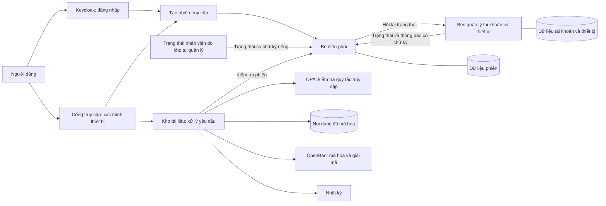
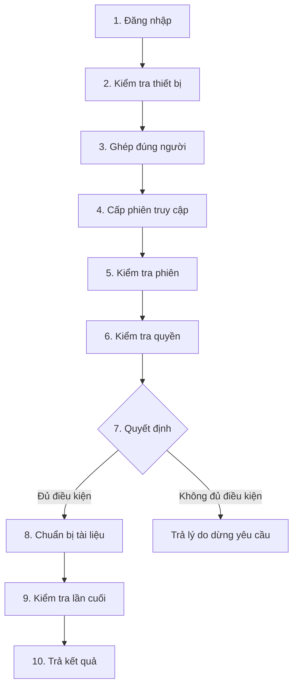

# Kiến trúc và luồng xử lý yêu cầu

## Bài toán và trách nhiệm

Một nhân viên đã đăng nhập và có phiên tại kho tài liệu. Sau đó bên quản lý tài khoản khóa tài khoản hoặc thu hồi thiết bị của nhân viên. Kho cần nhận biết thay đổi này để chặn các yêu cầu tiếp theo, dù phiên vẫn còn hạn.

| Thành phần | Trách nhiệm |
|---|---|
| Bên quản lý tài khoản | Xác nhận tài khoản và thiết bị của đối tác có còn hợp lệ; gửi thông báo thay đổi |
| Bộ điều phối | Liên kết đúng người, thiết bị và bên quản lý; cấp, kiểm tra và thu hồi phiên tại kho |
| Kho tài liệu | Quản lý thành viên, vai trò, nhãn, quyền có thời hạn, nội dung mã hóa và nhật ký |

Nhân viên do kho tự quản lý có nguồn trạng thái nội bộ của kho. Việc thuộc bên quản lý nào được xác định bằng liên kết đã đăng ký, không suy từ tên đăng nhập.

## Sơ đồ các thành phần

Ba cơ sở dữ liệu dùng chung một máy chủ PostgreSQL, có tài khoản dịch vụ và quyền kết nối riêng. Bên quản lý tài khoản và kho dùng khóa ký khác nhau. Bộ điều phối giữ khóa công khai để kiểm tra; dịch vụ tài liệu không được cấp khóa ký hay quyền đọc cơ sở dữ liệu của đối tác.

## Luồng xử lý từng bước

Sơ đồ và tên bước dưới đây thống nhất với PowerPoint. Bước 1–4 tạo phiên. Với một phiên đang dùng, mỗi yêu cầu tải đi qua bước 5–10; kết nối gửi yêu cầu vẫn cần thiết bị đã xác minh tại cổng.

Mọi bước xác minh có thể dừng ngay khi phát hiện điều kiện không hợp lệ. Ô Quyết định tổng hợp điều kiện tiếp tục; hệ thống không chờ đến bước này mới xử lý mọi lỗi.

| Bước | Thành phần và cách xử lý |
|---|---|
| 1. Đăng nhập | Keycloak xác thực người dùng và cấp thông tin đăng nhập có chữ ký. Trong trình thử, máy chủ dùng tài khoản mẫu đang chọn. |
| 2. Kiểm tra thiết bị | NGINX xác minh chứng thư của thiết bị. Thông tin thiết bị do người gửi tự khai không thay được kết quả xác minh tại cổng. |
| 3. Ghép đúng người | API và bộ điều phối kiểm tra tài khoản, bên quản lý và chứng thư có thuộc đúng liên kết đã đăng ký hay không. |
| 4. Cấp phiên truy cập | Bộ điều phối hỏi đúng bên quản lý, kiểm tra chữ ký và tính hợp lệ của phản hồi rồi tạo phiên gắn với người, thiết bị, cách kiểm tra và thời hạn. |
| 5. Kiểm tra phiên | Kho hỏi bộ điều phối xem phiên còn hạn, đúng thiết bị, đúng cách kiểm tra, chưa thu hồi và thuộc lần khởi động hiện tại. Khi dùng cách tự kiểm tra lại, thông tin trạng thái đã quá hạn phải được xác nhận lại. |
| 6. Kiểm tra quyền | Kho đọc quyền hiện tại và thông tin tài liệu; OPA xét vai trò, phòng ban, nhãn, chủ sở hữu, thời hạn và quyền riêng của tài liệu Hạn chế. |
| 7. Quyết định | Chỉ tiếp tục khi các điều kiện áp dụng đều đạt. Nếu không, trả nguyên nhân và mã yêu cầu để đối chiếu. |
| 8. Chuẩn bị tài liệu | API lấy bản mã, gọi OpenBao giải mã và đối chiếu mã băm nội dung. Tệp chưa được gửi ở bước này. |
| 9. Kiểm tra lần cuối | Ghi nhật ký bắt buộc, kiểm tra lại phiên, thời hạn quyền và lưu giữ trước khi hoàn tất giao dịch. |
| 10. Trả kết quả | Hoàn tất xử lý rồi gửi nội dung. Nếu một bước trước thất bại, không trả nội dung tài liệu. |

Đăng nhập và tạo phiên dùng `POST /sessions`. Các yêu cầu tiếp theo dùng bí mật phiên riêng của kho. Bộ điều phối chỉ lưu dạng băm của bí mật này; mã phiên công khai không đủ để truy cập. Bí mật phiên được công cụ điều khiển giữ trong bộ nhớ, không hiển thị như mã đăng nhập cho người dùng.

Liệt kê tài liệu, xem thông tin, đọc nhật ký và cảnh báo dùng kiểm tra phiên, quyền tương ứng; chúng không cần giải mã nội dung tài liệu.

## Cách kho cập nhật thay đổi

| Cách kiểm tra | Cơ chế | Khi thông báo bị mất |
|---|---|---|
| Kiểm tra khi đăng nhập | Xác nhận tài khoản và thiết bị khi cấp phiên | Phiên có thể tiếp tục dùng đến khi hết hạn; quyền tài liệu vẫn được kiểm tra |
| Thu hồi theo thông báo | Thêm thông báo thay đổi có chữ ký; nhận thông báo thì thu hồi đúng phiên liên quan | Có thể tiếp tục dùng phiên cũ do chưa biết thay đổi |
| Thu hồi theo thông báo và tự kiểm tra lại | Thêm việc hỏi lại định kỳ và hỏi lại khi thông tin đã lưu hết hạn | Phát hiện thay đổi và thu hồi; tạm dừng nếu chưa xác nhận lại được trạng thái |

Mỗi thay đổi quản trị tài khoản hoặc thiết bị ở bên quản lý tài khoản được ghi cùng thông báo chờ gửi trong một giao dịch. Thông báo có chữ ký, mã riêng và số phiên bản. Bộ điều phối bỏ qua thông báo trùng hoặc cũ; việc mở khóa không khôi phục phiên đã thu hồi.

Bộ đếm thu hồi tăng khi trạng thái quản trị thay đổi. Nhờ vậy, ngay cả khi tài khoản bị khóa rồi mở lại giữa hai lần kiểm tra, bộ điều phối vẫn nhận ra phiên cũ không còn được dùng. Việc gửi lại quan sát thiết bị định kỳ không tự tăng bộ đếm thu hồi.

## Thời gian và phạm vi bảo vệ

| Tham số mặc định | Giá trị |
|---|---|
| Thời hạn phiên | 900 giây |
| Thời gian tối đa dùng trạng thái đã kiểm tra | 5 giây |
| Khoảng cách giữa các lượt hỏi lại | 5 giây |
| Tuổi tối đa của thông tin quan sát thiết bị | 60 giây |

Thời gian thực tế được dùng trạng thái còn phụ thuộc thời điểm quan sát thiết bị. Ký hoặc nhận lại một thông tin cũ không biến nó thành quan sát mới. Khoảng hỏi lại là cấu hình lập lịch, không phải cam kết độ trễ tuyệt đối.

Thu hồi có thời gian truyền và xử lý. Kiểm tra cuối giảm khoảng thời gian giữa xác minh và trả nội dung; vẫn có thể tồn tại khoảng đua sau kiểm tra cuối. Phạm vi kết luận là các yêu cầu tiếp theo sau khi kho ghi nhận thu hồi. Tệp đã tải về máy nằm ngoài phạm vi này.

Xem thêm [quy tắc phối hợp](implementation-contract.md), [phân loại dữ liệu](data-classification.md) và [ma trận kiểm tra](test-matrix.md).
