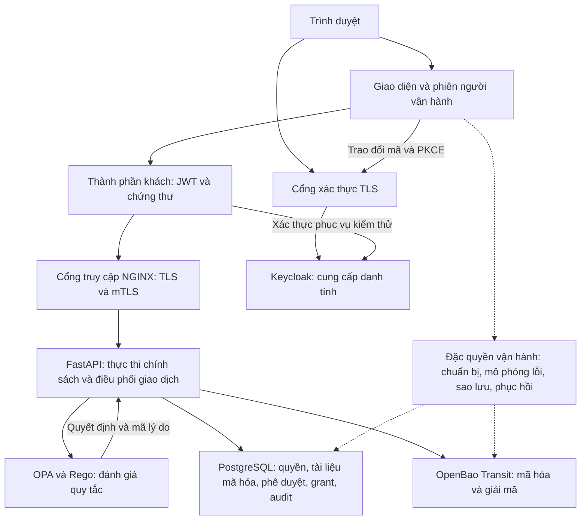

# Kiến trúc và ranh giới tin cậy

Cập nhật tài liệu ngày 25/10/2026 theo mã nguồn hiện hành. [Mục lục tài liệu](muc_luc.md) · [Cách sử dụng web](huong_dan_nhanh.md) · [Hợp đồng API](implementation-contract.md)

## 1. Phạm vi và thành phần

Nguyên mẫu bảo vệ kho tài liệu của hai phòng Kinh doanh (A) và Vận hành (B), theo ba nhãn Nội bộ, Mật và Hạn chế. Bộ khởi tạo `business-v1` có 20 tài liệu và tám tài khoản mẫu; số đang có trên web có thể lớn hơn vì cho phép thêm nhân viên và tài liệu. Nhãn được phân loại thủ công theo [quy chuẩn dữ liệu](data-classification.md).

Đơn vị quyết định là một yêu cầu, một tài nguyên và một hành động. Đăng nhập chỉ xác minh danh tính; quyết định còn dùng quyền hiện tại, phòng ban, chủ sở hữu, nhãn, thiết bị, thời hạn và grant. Nguyên mẫu chạy trên một host, sử dụng dữ liệu tổng hợp và phần mềm miễn phí.

Đường liền thể hiện yêu cầu nghiệp vụ hoặc xác thực; đường nét đứt thể hiện đặc quyền của người vận hành cục bộ. Thêm/sửa tài liệu và cấp/thu hồi grant từ web được chuyển thành yêu cầu qua gateway. Tạo nhân viên, chuẩn bị trạng thái và phục hồi thuộc miền vận hành riêng.

| Thành phần | Trách nhiệm | Nguồn hiện thực |
|---|---|---|
| `lab` | Giao diện, phiên, biểu mẫu quản lý, bài hướng dẫn, runner | [web.py](../lab/web.py), [management.py](../lab/management.py), `lab/static/`, `lab/templates/` |
| `gateway` | Xác minh chứng thư client, ghi đè thuộc tính đã xác minh, chuyển đúng B0/B1 | [nginx.conf](../infra/nginx.conf) |
| `keycloak` | OIDC, JWT ký RS256, đăng nhập tương tác và tài khoản mới | `infra/keycloak-realm.json`, `scripts/prepare.py` |
| `api`, `api-baseline` | PEP, lấy thuộc tính hiện tại, gọi OPA/KMS, giao dịch và audit | [main.py](../app/main.py), [security.py](../app/security.py) |
| `opa` | Đánh giá chính sách Rego | [bmdl.rego](../policies/bmdl.rego) |
| `postgres` | Registry, metadata, bản mã, phê duyệt, grant, audit | [db.py](../app/db.py) |
| `openbao` | Khóa Transit không cho xuất, lưu trữ Raft | `infra/openbao.hcl` |

Có tám dịch vụ Compose, gồm hai API. restic là công cụ sao lưu, không phải container dịch vụ thứ chín. Cấu hình image khóa bằng digest và thư viện nằm trong [Compose](../compose.yaml), [khóa image](../compose.lock.yaml), [khóa thư viện](../requirements.lock.txt); phiên bản quan sát được ghi trong [danh mục phần mềm](software-inventory.md).

## 2. Định danh và miền tin cậy

| Đường vào cục bộ | Mục đích |
|---|---|
| `http://localhost:8088` | Console của người vận hành tin cậy |
| `https://localhost:9443` | Đăng nhập Keycloak qua TLS |
| `https://localhost:8443/api/` | API B1, bắt buộc JWT và mTLS |
| `https://localhost:8444/api/` | API B0 đối chứng, cũng bắt buộc JWT và mTLS |

PostgreSQL, OPA, OpenBao và hai API không công bố cổng trực tiếp ra host. Các mạng là `edge`, `control`, `data`; hai mạng sau là mạng nội bộ. HTTP giữa một số dịch vụ nội bộ chưa được thay bằng mTLS toàn hệ thống.

- API kiểm tra chữ ký JWT, thuật toán, issuer, audience, thời hạn và ánh xạ `sub` với danh tính trong registry.
- Gateway xác minh chứng thư, gắn serial và kết quả TLS; API kiểm tra chứng thư đăng ký cho đúng chủ thể. Header do client tự khai không thay thế thuộc tính máy chủ.
- Đăng nhập tương tác dùng Authorization Code + PKCE; console kiểm tra state/nonce và giữ token phía máy chủ. Chế độ Chọn tài khoản dùng client kiểm thử cho phép người vận hành đóng vai tài khoản mẫu.
- Với thêm/sửa tài liệu khi có phiên Keycloak, máy chủ lấy danh tính từ phiên. Sửa ô username trong yêu cầu không đổi được người đang đăng nhập.
- Phiên console dùng cookie HttpOnly, SameSite và CSRF cho thay đổi; phiên hết hạn hoặc console khởi động lại có thể yêu cầu đăng nhập lại.

Console có Docker socket, quyền DB quản trị và vật liệu phục hồi; đây chưa phải cổng nhiều người dùng cho chủ thể không tin cậy. Chọn người phê duyệt trên web gửi một yêu cầu riêng bằng tài khoản quản trị được chọn. Cơ chế này minh họa tách danh tính và kiểm tra thật qua API, chưa hiện thực hàng đợi duyệt độc lập giữa nhiều người.

API nghiệp vụ không được gắn Docker socket, CA private key, private key client, DB admin credential hoặc root/unseal material OpenBao. API chỉ có quyền mật mã encrypt/decrypt cần thiết.

## 3. Quyền và nguồn trạng thái

OPA là thành phần đánh giá quy tắc, không phải toàn bộ PDP theo mô hình chức năng NIST. FastAPI lấy nguồn thuộc tính, xây input, xác minh quyết định, giữ khóa giao dịch, kiểm tra thời hạn và thực thi. Thiếu dữ liệu, phản hồi không hợp lệ hoặc lỗi phụ thuộc không được biến thành cho phép.

| Nguồn | Nội dung quyết định |
|---|---|
| `principals` | Danh tính, vai trò, phòng ban, active, phiên bản quyền |
| `devices` | Liên kết chủ thể/chứng thư, tuân thủ, thu hồi, rủi ro và thời điểm tín hiệu |
| `documents` | Chủ sở hữu, phòng ban, nhãn, phiên bản, lưu giữ, bảo toàn, xóa logic, bản mã và hash |
| `restricted_approvals` | Phê duyệt tạo/nâng nhãn Hạn chế: người nhận, tài liệu, phiên bản, mục đích, thời hạn, trạng thái đã dùng |
| `grants` | Quyền tải theo người nhận, tài liệu, phiên bản, hành động, thời hạn và trạng thái thu hồi |
| `audit`, `alerts`, ledger | Dấu vết yêu cầu, thay đổi quản trị và trạng thái cần đối chiếu sau phục hồi |

Điều kiện chung B1 gồm tài khoản hoạt động, chứng thư đúng người, thiết bị chưa thu hồi, compliant, rủi ro NORMAL và tín hiệu còn mới. Thời hạn tín hiệu là 60 giây; bộ giả lập làm mới mỗi 20 giây khi `auto_refresh` bật.

| Tài liệu | Xem metadata | Tải và sửa thông tin |
|---|---|---|
| Nội bộ | Nhân viên/trưởng phòng cùng phòng | Cùng phạm vi, nếu các điều kiện chung hợp lệ |
| Mật | Nhân viên sở hữu hoặc trưởng phòng cùng phòng | Cùng phạm vi, nếu các điều kiện chung hợp lệ |
| Hạn chế | Trưởng phòng cùng phòng | Trưởng phòng cùng phòng, có grant đúng người/tài liệu/phiên bản/action `download`, còn hạn, chưa thu hồi và người duyệt khác người nhận |

Kiểm toán đọc audit/cảnh báo; quản trị an toàn quản lý trạng thái và phê duyệt, không mặc nhiên đọc nội dung. Sở hữu một tài liệu Hạn chế không tự cấp quyền. Danh sách nghiệp vụ được lọc theo quyền metadata; catalog mô tả trên console là dữ liệu của miền vận hành, không phải phản hồi nghiệp vụ bị từ chối.

### 3.1. Thêm Hạn chế và sửa thông tin

1. Quản trị an toàn gửi phê duyệt tạo mới cho trưởng phòng. Máy chủ đặt định danh tài liệu dự kiến, phiên bản 1, phòng ban, mục đích `create` và thời hạn.
2. Trưởng phòng thêm tệp với nhãn `restricted` và `approval_id`. API kiểm tra danh tính/thiết bị, người nhận, mục đích, thời hạn và người duyệt hiện còn quyền.
3. API mã hóa và lưu tài liệu, grant tải ban đầu, trạng thái phê duyệt đã dùng cùng giao dịch PostgreSQL; không lưu tạm một bản Mật rồi nâng nhãn.
4. Phê duyệt tạo chỉ được sử dụng thành công một lần. Grant tải được dùng ở nhiều yêu cầu trong thời hạn, nếu các điều kiện khác vẫn hợp lệ. Hủy giao dịch không tạo tài liệu dở dang; lỗi ledger sau commit phải được đối chiếu bằng cách làm mới dữ liệu trước khi gửi lại.

`PUT /documents/{id}` kiểm tra quyền tải hiện tại theo B1, kể cả khi gọi đường API B0. Chức năng sửa hiện tại đổi tên hoặc nâng nhãn, chưa thay thế nội dung tệp. Xem metadata chưa đủ để sửa. Không được hạ nhãn; quyền nội dung không cho phép sửa thời hạn/bảo toàn.

Nâng Nội bộ/Mật lên Hạn chế cần phê duyệt mục đích `upgrade` cho đúng tài liệu và phiên bản kế tiếp. Máy chủ tăng phiên bản, giới hạn lưu giữ theo nhãn mới và cấp grant cho phiên bản mới. Đổi tên giữ phiên bản kiểm soát tài liệu. Một người có thể có nhiều grant cho cùng tài liệu/phiên bản. Yêu cầu tải và sửa chỉ bị chặn do thiếu grant khi mọi grant phù hợp đều đã bị thu hồi, hết hạn hoặc không còn đúng phiên bản; thu hồi một dòng không vô hiệu hóa các grant khác.

### 3.2. B0 và B1

B1 là chính sách đề xuất theo trạng thái hiện tại. B0 là đối chứng quyền đọc tĩnh do nhóm tạo, dùng thuộc tính đối chứng `b0_role`/`b0_department` trong JWT và bỏ qua một số điều kiện owner/nhãn/sức khỏe thiết bị/rủi ro/grant/active đối với đường đọc được chọn. B0 vẫn kiểm tra danh tính, quan hệ chứng thư, tài nguyên tồn tại và lưu giữ.

Các thuộc tính đối chứng này được cấu hình trong Keycloak khi chuẩn bị hoặc tạo tài khoản, tách khỏi registry hiện tại. Cập nhật registry không tự đồng bộ chúng, kể cả khi xin token mới.

Các thao tác sửa và quản trị không dùng B0 để bỏ qua kiểm tra B1. B0/B1 cùng dùng TLS, mTLS, dữ liệu, Transit và audit. Đối chứng không phải kiến trúc riêng của Google/Microsoft và không chứng minh hệ thống vượt trội toàn diện.

## 4. Bảo vệ dữ liệu và vận hành

Nội dung được mã hóa bằng OpenBao Transit trước khi lưu PostgreSQL; metadata phục vụ quyết định vẫn ở dạng rõ có kiểm soát. Khóa Transit không cho phép xuất; token ứng dụng không được quản trị/rotate/export khóa. Hash hỗ trợ kiểm tra toàn vẹn sau giải mã và phục hồi.

Lưu giữ 180/90/30 ngày theo Nội bộ/Mật/Hạn chế là giả định thử nghiệm. Hết hạn chặn đọc; xóa chỉ được thực hiện khi đúng quyền, đã qua lưu giữ và không có legal hold. Xóa tạo tombstone, không làm snapshot cũ biến mất. Chưa có scheduler tự xóa/prune mọi bản sao.

Audit ghi Request ID, chủ thể, tài nguyên, hành động, quyết định, lý do và phiên bản chính sách. Ghi audit bắt buộc phải thành công trước trả bản rõ. Trạng thái phản hồi đã chuẩn bị không đồng nghĩa client đã nhận trọn file. Năm lần deny của một chủ thể trong 60 giây tạo cảnh báo mẫu; bước xử lý/thu hồi do người vận hành thực hiện riêng.

Sao lưu tạm dừng ghi nghiệp vụ, tạo cặp PostgreSQL dump + OpenBao Raft snapshot, kiểm tra hash và lưu vào repository restic mã hóa. Phục hồi dựng DB/KMS cô lập, xác minh nội dung, đối chiếu ledger quyền thu hồi/tombstone mới hơn checkpoint, xóa phê duyệt tạo/nâng nhãn chờ trong bản phục hồi rồi kiểm tra trạng thái. Nó không thay thế hệ thống chính và không khôi phục đầy đủ Keycloak/PKI/host. Repository cùng nằm trên ổ E chưa bảo vệ trước mất ổ vật lý.

## 5. Căn cứ thiết kế và bằng chứng

Thiết kế vận dụng quan hệ danh tính, kiểm kê, chứng thư và proxy từ BeyondCorp; cách xem xét nhiều miền bảo vệ từ Microsoft Zero Trust; thuật ngữ và mô hình chức năng từ NIST SP 800-207; truy vết yêu cầu theo SABSA rút gọn. Chính sách ba nhãn, grant, phê duyệt tạo Hạn chế, phối hợp thành phần và bộ kiểm chứng là phần cụ thể hóa của nhóm.

Các tài liệu tham chiếu đã dùng trong báo cáo: [NIST SP 800-207](https://csrc.nist.gov/pubs/sp/800/207/final), [BeyondCorp 2014](https://www.usenix.org/system/files/login/articles/login_dec14_02_ward.pdf), [Microsoft Zero Trust adoption framework](https://learn.microsoft.com/en-us/security/zero-trust/adopt/zero-trust-adoption-overview), [SABSA Executive Summary](https://sabsa.org/sabsa-executive-summary/). Danh mục công nghệ và nguồn chính thức nằm trong [software-inventory.md](software-inventory.md); tài liệu tham chiếu không thay thế bằng chứng chạy nguyên mẫu.

Xem [ma trận kiểm chứng](test-matrix.md), [cách tái lập](reproduction.md) và [kết quả](ket_qua_kiem_chung.md). Lượt chuẩn ngày 19/10 và kiểm tra bổ sung ngày 21/10 là hai phạm vi khác nhau; không cộng số kiểm tra để tạo một kết quả tổng hợp mới.

Giới hạn chính: dữ liệu giả lập; tín hiệu thiết bị chưa lấy từ thiết bị thật; nội bộ chưa có mTLS toàn bộ; log chưa chống quản trị viên host; chưa kiểm chứng HA/tải đồng thời; bản rõ đã cấp không thể thu hồi bằng đổi quyền. Mô hình triển khai trên một máy chưa bảo đảm cách ly khi host bị chiếm toàn bộ.
